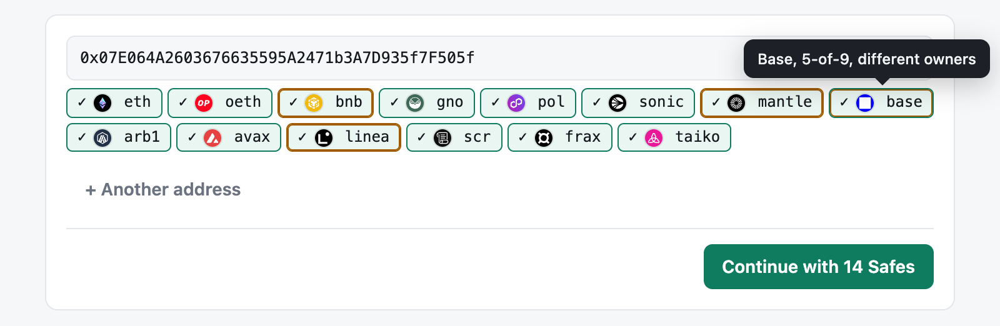
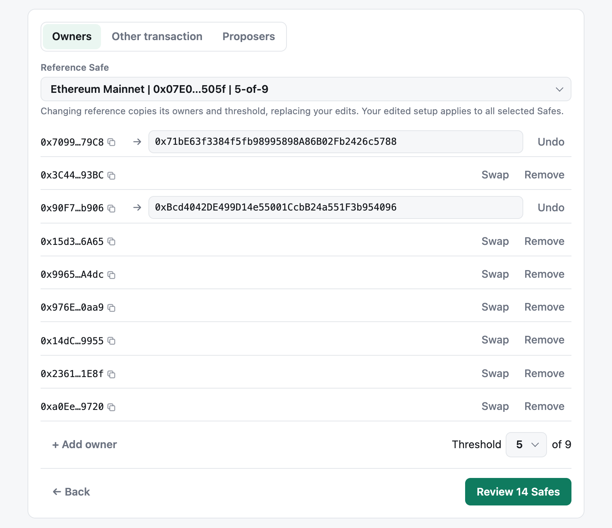
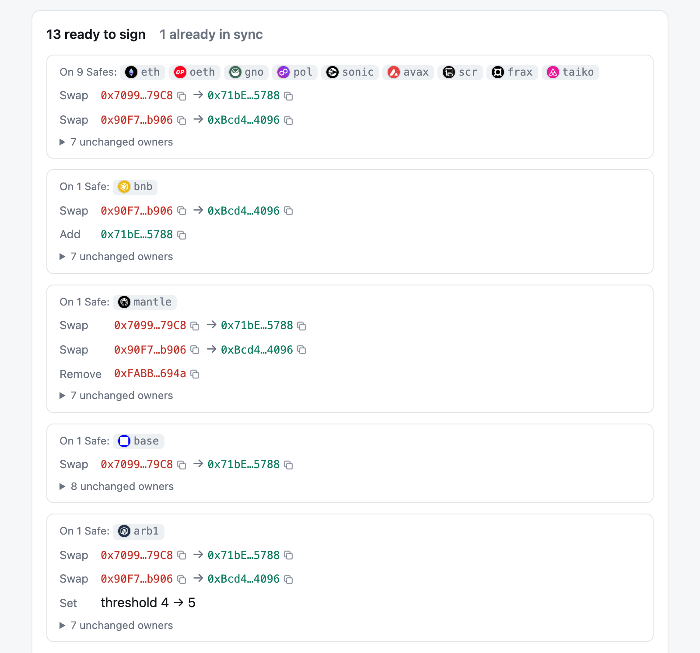
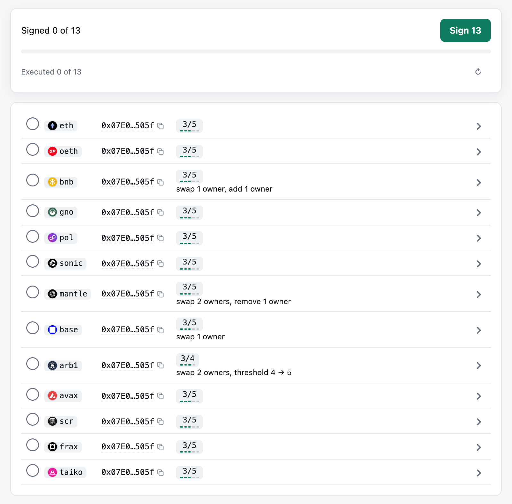
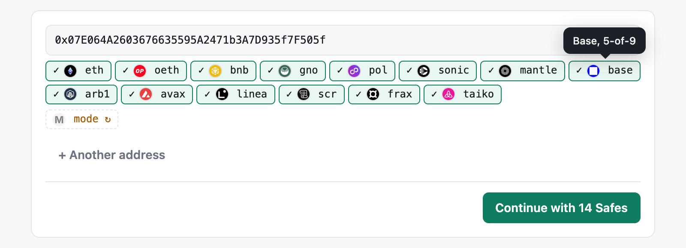
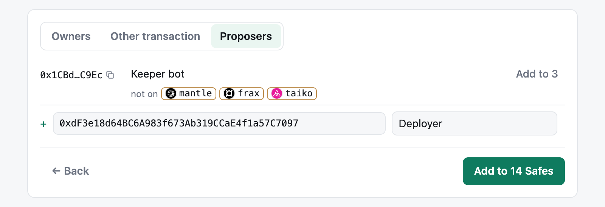

# Safe Sync

Synchronize Safe owners on every chain. **https://safe-sync.wavey.info**

A Safe on many chains drifts over time: its owners and threshold stop matching. Fixing it by hand means
a different transaction for every chain, and every signer clicking through each one.

Safe Sync does it for you:

- **Diffs the owners.** It reads every chain and compares each Safe's owners and threshold with one
  target.
- **Plans the calldata.** Each Safe gets exactly the calls it's missing: swaps, adds, removes, a
  threshold change. Every transaction is simulated on its chain and its hash checked against the Safe
  contract.
- **Keeps clicks to a minimum.** The proposer goes through three screens and shares one link. Signers
  open it, connect and click **Sign N**, then confirm one wallet prompt per Safe, with no clicking
  through Safe{Wallet} chain by chain.

It's a stateless web app: the signing link carries the transactions, and each chain's Safe Transaction
Service tracks signatures and status.

### 1. See the drift

Paste the Safe's address. Safe Sync finds it on every chain and marks the odd ones out in amber. Click
a chain to leave it out.

<picture>
  <source media="(prefers-color-scheme: dark)" srcset="docs/1-drift-dark.png">
  
</picture>

### 2. Set the target

Choose the owners and threshold every chain should end up with. It starts from the most common setup;
swap, add or remove owners from there.

<picture>
  <source media="(prefers-color-scheme: dark)" srcset="docs/2-target-dark.png">
  
</picture>

### 3. Review each chain's fix

Each Safe is compared with the target on its own and gets only the calls it's missing. Here base was
half rotated, bnb had dropped a signer without adding the new one, mantle had an extra owner and arb1
a lower threshold. Linea already matches, so it's skipped.

<picture>
  <source media="(prefers-color-scheme: dark)" srcset="docs/3-review-dark.png">
  
</picture>

### 4. Sign it in one sitting

Copy the signing link and send it to the other signers. Each one checks the fingerprint next to the
title with whoever sent it, connects a wallet and clicks **Sign 13**. Signatures go to the Safe
Transaction Service, so Safe{Wallet} shows them too.

<picture>
  <source media="(prefers-color-scheme: dark)" srcset="docs/4-sign-dark.png">
  
</picture>

### 5. Execute, and every chain matches

Once a Safe has enough signatures, anyone with gas clicks **Execute**. Open the Safe again afterwards
and the amber is gone: the same owners and threshold everywhere.

<picture>
  <source media="(prefers-color-scheme: dark)" srcset="docs/5-synced-dark.png">
  
</picture>

### Proposers on every chain too

Proposers (Safe{Wallet} delegates) propose transactions without being owners. Choose **Proposers** next to
Owners to see them on every chain at once, with any chain one is missing from. An owner adds or removes
one everywhere with a single signature: no transaction, nothing to execute.

<picture>
  <source media="(prefers-color-scheme: dark)" srcset="docs/6-proposers-dark.png">
  
</picture>

## Good to know

- **No backend.** The link carries every transaction in its `#` fragment, which browsers never send
  to a server. Your browser reads the chains through public RPCs and talks to the Safe service itself.
- **Signatures aren't lost.** They're also kept in your browser and uploaded again whenever you open
  the link.
- **Queued transactions are left alone.** A Safe with something already queued and signed gets the
  next nonce after it, unless you choose to replace it.
- **Not only owners.** *Other transaction* takes a Safe{Wallet} transaction link or Transaction Builder
  JSON and repeats it on every Safe.
- **Proposers** can propose a link's transactions; their signature doesn't count toward the threshold.
  Like Safe{Wallet}, Safe Sync lists the ones named for that Safe, not the ones an owner named for all of
  its Safes.
- **No Safe service on a chain?** Signers copy their signatures to the executor by hand.
- **Settings** (the gear): your own RPC or Safe service for any chain, and an optional Safe API key.
  They stay in your browser.
- **Not supported:** Safe before 1.3.0, contract owners (EIP-1271), WalletConnect, non-zero gas or
  refund fields.

## Try it locally

```bash
bun install
bun run sandbox
```

The sandbox runs 14 local chains, a mock Safe service and a sandbox wallet that signs as any test
account. Nothing it signs or executes reaches a real network or Safe service. `bun run sandbox:simple` is a 2-of-2 Safe on
local-only chains, for trying your own wallet (remove those networks from it afterwards).

## Develop

```bash
bun test              # unit tests and the sandbox end to end (needs anvil)
bun run build         # dist/safe-sync.html and its sha256
bun run dev           # build and serve on http://localhost:5173
bun run screenshots   # retake the screenshots above (needs Chrome)
```

`src/safe.ts` is the core: finding Safes, owner sync, hashing, simulation and the link format.
`src/service.ts` is the Safe service client and `src/app.ts` the UI.

## Host it

It's one static file, so any HTTPS host works (not `file://`, where wallets don't inject). This repo
deploys to Vercel from `main` and serves `dist/safe-sync.html` exactly as committed, so the live file
matches the sha256 the build prints: rebuild and commit `dist` with every change. Don't put a Safe API
key in the build; users paste their own in Settings.
